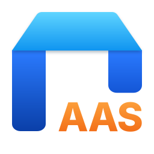
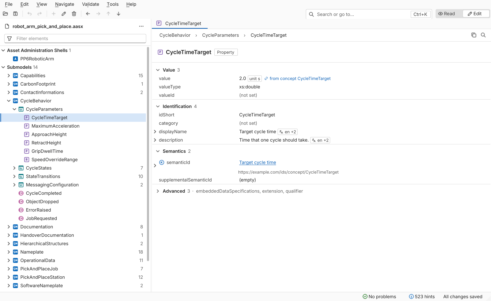
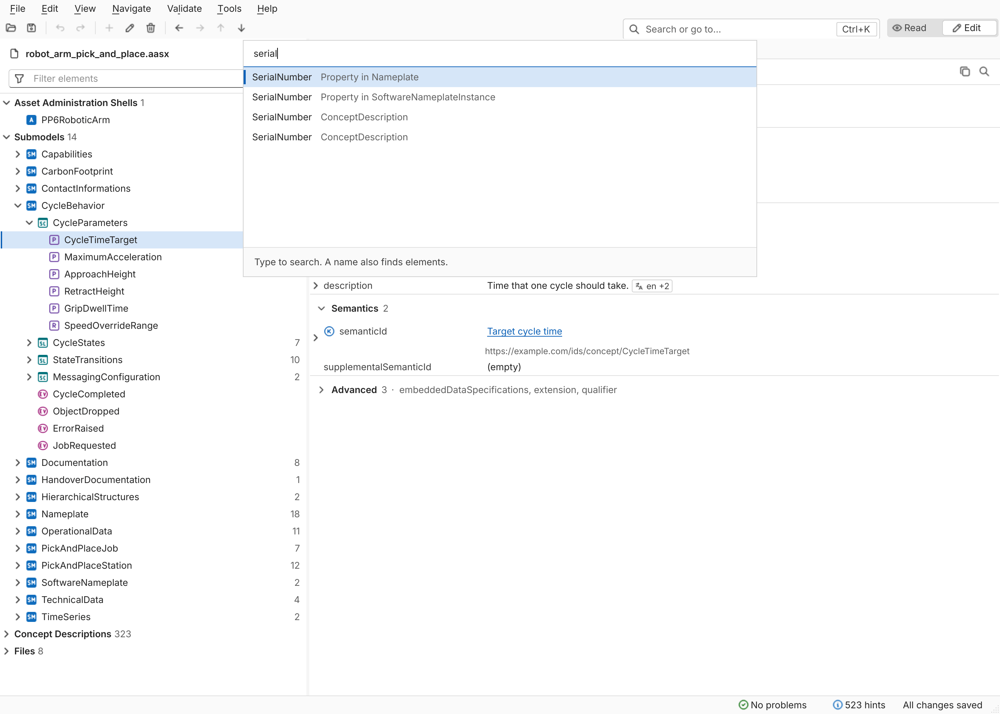
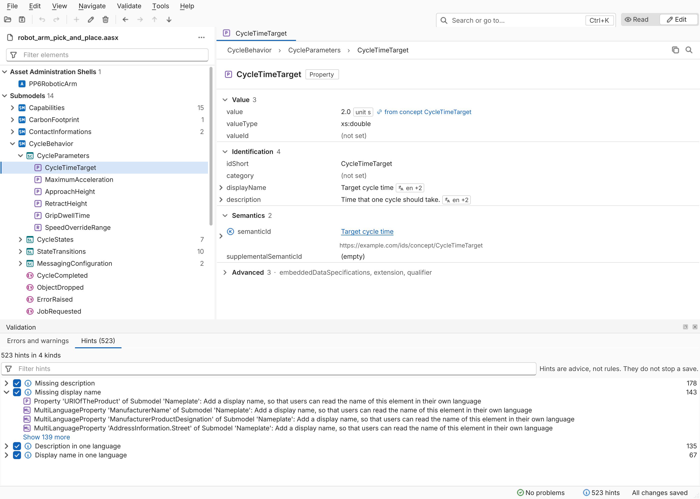
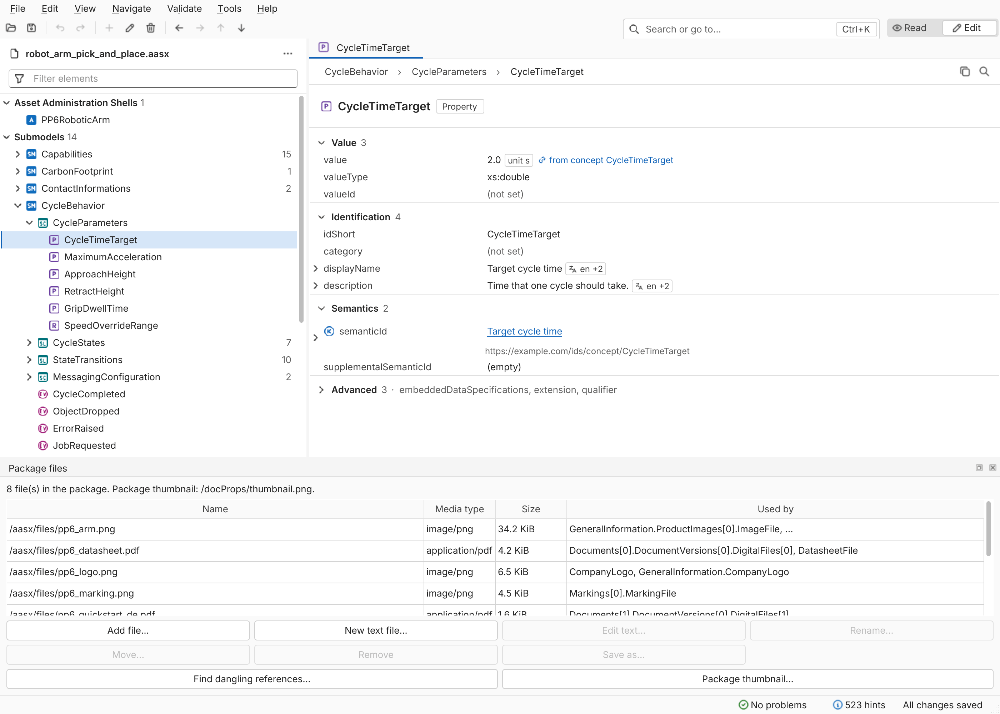
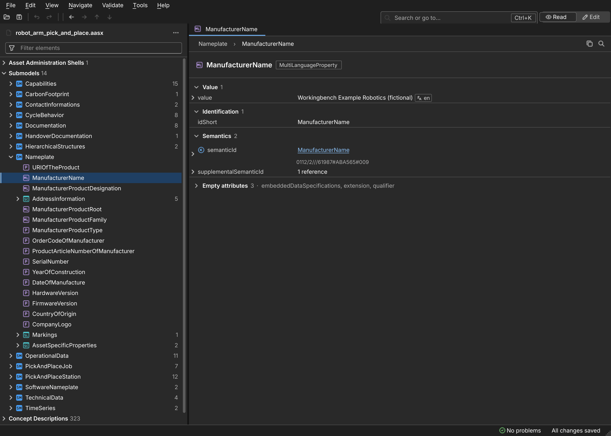
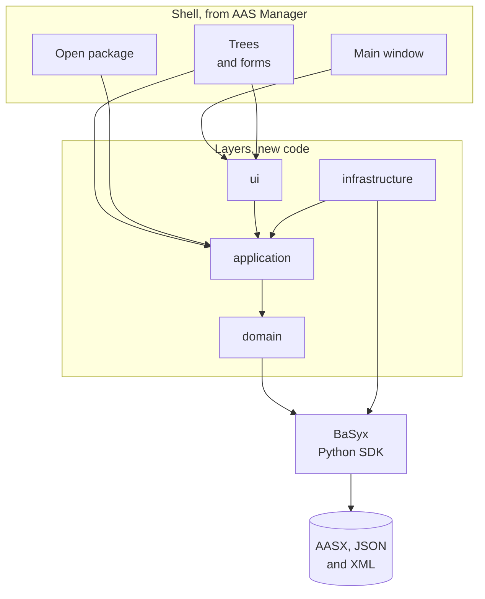
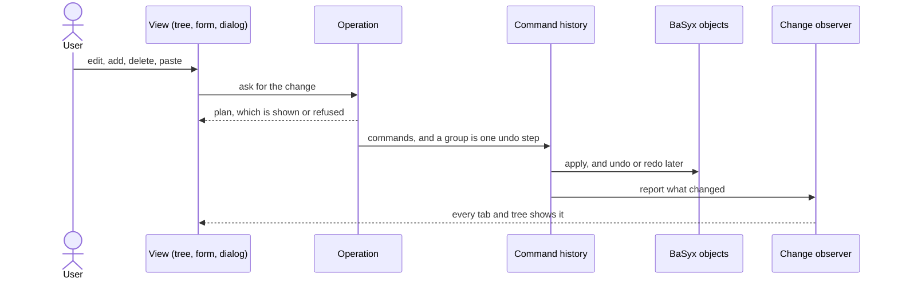

<div align="center">



# AAS Workingbench

**A desktop editor for Asset Administration Shell packages.**

(a fork of [rwth-iat/aas_manager](https://github.com/rwth-iat/aas_manager), GPL-3.0)

Open, edit, validate and save AASX, JSON and XML files of metamodel V3.1, with every change one undo away.

[](https://github.com/ifonso/AAS-Workingbench/releases)
[](LICENSE)
[](https://github.com/ifonso/AAS-Workingbench/actions/workflows/ci.yaml)
[](pyproject.toml)
[](https://github.com/admin-shell-io/aas-specs-metamodel)

[Screenshots](#screenshots) · [What it does](#what-the-editor-does) · [How it is built](#how-it-is-built) · [Build](#build) · [Documentation](docs/README.md) · [Contributing](#contributing)

</div>

---

AAS Workingbench is a desktop editor for the files of the Asset Administration Shell, written in Python with PyQt6 on the Eclipse BaSyx SDK.
An edit is a command with a plan and a place in the undo history, and a save checks the package before it writes.
The aim is the robustness of [AASX Package Explorer](https://github.com/eclipse-aaspe/package-explorer) with a more pleasant interface, and [Purpose](#purpose) says how far that is.

- **Every edit is one undo step.** Edits, adds, deletes, moves and pastes go through one history for each package, and Read mode refuses changes.
- **It reads like a document.** The detail of an element is in sections (Value, Identification, Semantics), a text in several languages reads in the first of your default languages, and a semanticId shows the name of its concept as a link.
- **It finds things fast.** `Ctrl+K` searches the commands and the elements, the tree has a filter, and a click on a reference opens its target, with Back and Forward.
- **It checks what you type and what you save.** Values are checked against their XSD type as you type, validation rules cover constraints of the metamodel that the SDK does not enforce, and hints give advice that never stops a save.
- **It keeps references and files whole.** A rename updates the references that point at the renamed object, and a panel manages the files stored in a package.
- **It does not lose your work.** A save writes a temporary file and then replaces the target, so a failed save leaves the original intact, and crash recovery offers the changed packages at the next start.

<p align="center">
  <picture>
    <source media="(prefers-color-scheme: dark)" srcset="docs/images/editor-dark.png">
    
  </picture>
</p>

<p align="center"><sub>The example package of a pick and place robot arm, in Edit mode. The picture follows the theme of your GitHub.</sub></p>

## Screenshots

<table>
  <tr>
    <td width="50%" valign="top">
      
      <p align="center"><b>Command palette.</b> <code>Ctrl+K</code> searches the commands and the elements of the package.</p>
    </td>
    <td width="50%" valign="top">
      
      <p align="center"><b>Validation and hints.</b> Errors and warnings are checked before a save, and hints are advice, in groups by kind.</p>
    </td>
  </tr>
  <tr>
    <td width="50%" valign="top">
      
      <p align="center"><b>Package files.</b> The files stored in the package, with the elements that use each one.</p>
    </td>
    <td width="50%" valign="top">
      
      <p align="center"><b>Read mode, dark theme.</b> Nothing can be changed, and the empty attributes are folded away.</p>
    </td>
  </tr>
</table>

The pictures show the package in [`example/`](example/README.md), on Linux.
They were drawn without a display (`QT_QPA_PLATFORM=offscreen`), so they show the window without the frame of the desktop.

## Purpose

AAS Workingbench is a fork of [AAS Manager](https://github.com/rwth-iat/aas_manager) (`rwth-iat/aas_manager`), developed at RWTH Aachen.
It aims to edit AASX files with the same robustness as [AASX Package Explorer](https://github.com/eclipse-aaspe/package-explorer), with a more pleasant interface, and to do so on Linux, Windows and macOS.
Package Explorer is the reference, and the editor is not at parity with it yet: some features are missing, and a few are out of scope on purpose.
[Feature parity](docs/software/feature-parity.md) tracks the gap, and the [V1 editor plan](docs/planning/v1-editor-plan.md) lists what is out of scope.

The project also plans AI features that make modeling, verification and the use of industry standards easier, and an MCP server.
None of that exists yet.
The one LLM feature today is inherited from upstream: a [handover documentation tool](src/aas_workingbench/tools/handover_doc_llm/README.md) that drafts a Handover Documentation submodel from a PDF through a model provider that you configure.

The editor has been run on Windows and on Linux in the current work.
Continuous integration runs the checks on Ubuntu, and the release workflow builds a zip for Windows and an AppImage for Linux.
Nothing builds for macOS, so macOS is a goal and not a claim.

## What the editor does

It opens, edits and saves AASX, JSON and XML packages for metamodel V3.1.x, and reads V3.0 files as V3.1, as the SDK does.
Every edit, add, delete and paste can be undone, and a Read mode refuses changes.
Values are checked against their XSD type as you type, renames update the references that point at the renamed object, and the files stored in a package can be managed from a panel.
A set of validation rules covers constraints of the metamodel that the SDK does not enforce.
The [changelog](CHANGELOG.md) has the full list, including the known limits, and [`docs/`](docs/README.md) has the architecture, decision records and guides.
The folder [`example/`](example/README.md) holds a complete, fictional package of a pick and place robot arm to open in the editor, with the script that builds it.

## How it is built

Two generations of code work together.
The shell is the window, the trees and the forms that came from AAS Manager, and it makes its rows and editors from the type hints of the BaSyx classes at run time.
New features go into four layers below it, where the rules of the AAS and the use cases have no PyQt, so they are tested without a window.
All access to AAS data goes through the BaSyx SDK.



An arrow reads "uses".

| Part | Where | What it holds |
|---|---|---|
| Main window | `editorApp.py`, `design.py` | The window, the menus, the command bar and the panels |
| Trees and forms | `treeviews/`, `models/`, `widgets/`, `dialogs.py` | The item models, the tree views and the forms made from type hints |
| Open package | `package.py` | The objects, the files and the thumbnail of the package that is open |
| `ui` | `ui/` | Panels, dialogs, the registered actions and the theme |
| `application` | `application/` | Operations, commands and the undo history, the save flow, the change observer |
| `domain` | `domain/` | The rules of the AAS, validation and references, with no PyQt and no I/O |
| `infrastructure` | `infrastructure/` | Reads and writes packages through the SDK, and keeps the log |

`domain` and `application` never import PyQt, and a test fails if they do.

An edit does not change an AAS object from a view.
It is a command, and the views learn of it from one observer for each package:



A save goes the same way down: `application/save.py` checks the package and warns, and `infrastructure/package_io.py` writes a temporary file and replaces the target.
The [architecture guide](docs/software/architecture.md) has the modules of each layer and the known problems of the structure, and the [decision records](docs/software/adr/README.md) say why.

## Build

You need [uv](https://docs.astral.sh/uv/getting-started/installation/) and Git.
You do not need to install Python, because uv fetches the version the project asks for (3.11 or newer).

On Windows, some template paths exceed 260 characters, so clone with long paths enabled:

```sh
git clone -c core.longpaths=true https://github.com/ifonso/AAS-Workingbench.git
cd AAS-Workingbench
```

If you cloned without it, run `git config core.longpaths true` in the clone, then `git reset` and `git checkout -- .`.
On Debian and Ubuntu, Qt also needs two system libraries, which CI installs:

```sh
sudo apt-get install libegl1 libopengl0
```

Install the locked environment and start the editor from source:

```sh
uv sync --locked
uv run python -m aas_workingbench
```

Running the editor rewrites the tracked file `src/aas_workingbench/settings/settings.ini`.
Do not commit that change, and discard it with `git checkout -- src/aas_workingbench/settings/settings.ini`.

CI checks the code and runs the small and medium tests with these commands:

```sh
uv run ruff format --check
uv run ruff check
uv run pyright
uv run pytest -m "small or medium"
```

Pyright prints warnings for older modules, and they do not fail the check.
If GNU Make is installed, `make check` runs the same four commands, and `make` lists the other targets.

To build a stand-alone executable with PyInstaller:

```sh
uv run --group build pyinstaller --noconfirm aas_workingbench.spec
```

The result is the folder `dist/AAS_Workingbench`, which holds the executable `AAS_Workingbench` (`AAS_Workingbench.exe` on Windows).
[`packaging/README.md`](packaging/README.md) says how to make the release files from it: the Windows zip and the Linux AppImage.
`make build` runs the same command.

## Related projects

These are the standards and foundations that the editor builds on.

| Project | Why it matters |
|---|---|
| [eclipse-basyx/basyx-python-sdk](https://github.com/eclipse-basyx/basyx-python-sdk) | The Python SDK that holds the metamodel classes and reads and writes AASX, JSON and XML. The editor installs a fork, [`rwth-iat/basyx-python-sdk`](https://github.com/rwth-iat/basyx-python-sdk), pinned to a commit in `pyproject.toml`. |
| [admin-shell-io/aas-specs-metamodel](https://github.com/admin-shell-io/aas-specs-metamodel) | The specification of the metamodel, with the constraints that the editor validates. |
| [admin-shell-io/aas-specs-measurement-units](https://github.com/admin-shell-io/aas-specs-measurement-units) | The specification of how measurement units are described in the AAS. |

## Contact

Write to [contato@ifonso.com.br](mailto:contato@ifonso.com.br), or open an issue at [github.com/ifonso/AAS-Workingbench](https://github.com/ifonso/AAS-Workingbench/issues).

## Contributing

Issues and pull requests are welcome at [github.com/ifonso/AAS-Workingbench](https://github.com/ifonso/AAS-Workingbench/issues).
Start with [CONTRIBUTING.md](CONTRIBUTING.md), which points to the guides in [`docs/contributing/`](docs/contributing/development.md).

## License and notices

AAS Workingbench is licensed under the GNU General Public License v3.0. See [LICENSE](LICENSE).
Parts of the code descend from AAS Manager, copyright Igor Garmaev and contributors, which is licensed under the same terms.
[NOTICE](NOTICE) lists the third-party material that the repository contains or installs, with the license it names for each.

The Asset Administration Shell, its specifications and submodel templates, and the global dictionaries such as ECLASS and the IEC Common Data Dictionary belong to their owners.
This project is not affiliated with or endorsed by them.
The software ships no dictionary as such, although templates and packages may refer to dictionary entries or hold some, and it grants no rights over any.
You are responsible for the licenses of the dictionaries and data that you load.
