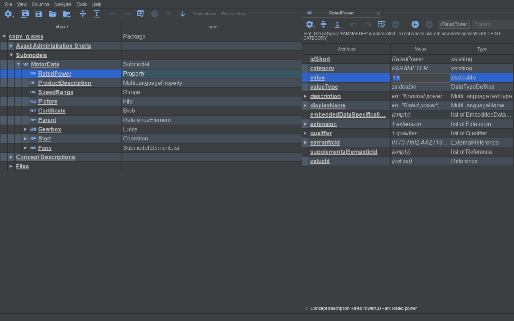
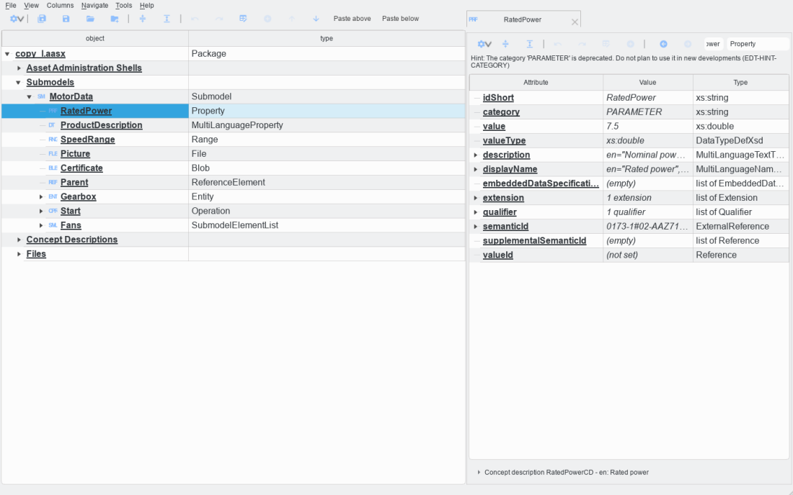
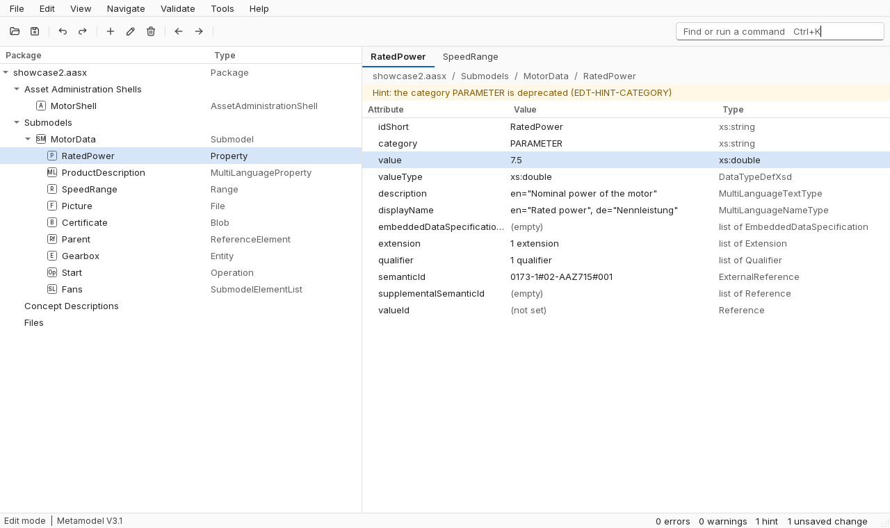
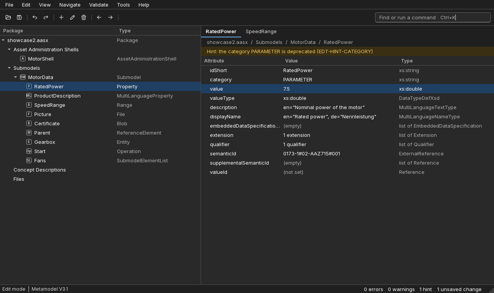

# UI and UX plan

**Goal:** an editor that is faster to read and to work in, on Linux, Windows, and macOS, with the logic of Fluent 2 adapted to deep trees and dense attributes.

**Status:** Proposed. Nothing is implemented, and the [decisions for the owner](#7-decisions-for-the-owner) are open.

**In short:** keep native title bars and Qt widgets. Generate the style sheet and the palette from one table of tokens, with Inter as the font and Tabler as the action icons, and draw a small set of AAS kind icons here. Fix the flows that cost the most first: search, the validation count, adding a qualifier, and command discovery. No new Python dependency is needed.

## How this was checked

| What | How | Limit |
|---|---|---|
| Current look and flows | The real `main` walked offscreen with `widget.grab()` on `showcase2.aasx`, in the `grey` and `light` themes, on Qt 6.12, plus the earlier picture of a real Windows window | Offscreen pictures show layout and text, not real scaling or focus. QtWebEngine shows black |
| Qt abilities | Small probes on Windows 11, with the `windows` and `offscreen` platform plugins | **Linux and macOS were not run.** Each claim about them below is marked *unverified* |
| Contrast | WCAG 2 formula, computed by a script | Against the token pairs listed here, not against every widget |
| Licenses | The license files read from each project's repository | Not legal advice |
| Validation flow | The sample has no findings, so the dock was seen empty | The list with findings was read in code, not in a picture |

No `graphify-out/` folder exists in this repository, so no graph was used.

## 1. Diagnosis

Ranked by what each costs a user. Problems of flow come first because they cost more than looks.

### UX problems

| # | Problem | Evidence | Cost |
|---|---|---|---|
| U1 | **Search in the tree is hard to reach and reports wrong results.** `Ctrl+F` is bound only in the tab (`widgets/tab.py:508`). The tree's bar opens from View, Appearance, SearchBar. The recursive filter keeps parents, and `SearchProxyModel.search` collects them too: `Speed` matches one element and returns **4**, the first being the package, so the selection does not move. There is no result count, and only names are searched, not values | Probe log; `models/search_proxy_model.py:144`; picture below | The main way to find an element in a deep tree fails silently |
| U2 | **Adding a qualifier takes four actions before the first field.** Select the element, select the `qualifier` row in the tab, press the `+` that only then enables, press "Add Item" in a dialog that holds nothing else. The form then shows `value_type` and `semantic_id`, the Python names that [ADR 0022](../software/adr/0022-attribute-vocabulary.md) removed from tabs, and "Create" buttons | [Add qualifier form](ui-ux/before-add-qualifier.png) | A frequent edit is slow, and the words change between tab and dialog |
| U3 | **The state of the package is not visible.** The status bar is empty. The Validation dock starts hidden and does not run rules until it is shown. The bar in a tab says `Hint: The category 'PARAMETER' is deprecated` while the dock says `No findings` and `Info (0)` for the same package. [ADR 0015](../software/adr/0015-validation-in-the-editor.md) keeps hints out of the dock on purpose, but nothing on screen explains it | [Docks](ui-ux/before-g-docks.png) | A person learns about errors at Save time |
| U4 | **Commands are hard to find.** Many live only in context submenus: Package files 20, Concept descriptions 14, Qualifiers and bulk changes 11. There is no Edit menu, and no search over commands. Top-level "Columns" sits among File and View | Probe log of the menu | Experts remember, others never find a feature |
| U5 | **Save is ambiguous.** Two near-identical floppy icons sit side by side, Save All first. `Ctrl+S` is Save All (`settings/shortcuts.py:29`), which differs from the usual meaning when two packages are open | [Dark before](ui-ux/before-g-inline.png) | Saving another package than intended |
| U6 | **The first screen is two empty panels.** The left says "Drop AAS files here", the right has a "Welcome" tab that shows "There are no elements in this view", `Address Line` and `NoneType`. Recent files are one submenu away, and New and Open are unlabeled icons | [Empty start](ui-ux/before-g-empty.png) | The first minute teaches nothing |
| U7 | **Docks fight for one strip.** With three docks open, the buttons cut to `ew text file` and `ind dangling references`, the Validation headers to `everit` and `ocatic`. Dock positions are not saved: the code saves header states and no `QMainWindow.saveState` | [Docks](ui-ux/before-g-docks.png) | Reading requires dragging, every session |
| U8 | **The address line is too narrow to use.** At 1440 pixels it shows `/RatedPower` from a much longer path, and the type next to it is an input-like field | [Dark before](ui-ux/before-g-inline.png) | The location of a tab cannot be read |
| U9 | **Two toolbars repeat each other.** The tree and tab bars both have gear, collapse, expand, undo, redo, edit, and add, and the `+` acts on a different row in each | [Light before](ui-ux/before-l-prop.png) | A person has to know which focus an icon means |
| U10 | **Little accessibility work.** The search for `setAccessibleName`, `setBuddy`, and `setTabOrder` in `src/aas_editor` found one `setBuddy` and one `setAccessibleDescription` | Code search | Screen readers and keyboard-only use are weak |

The save warning itself ([`IssuesDialog`](../../src/aas_editor/ui/save_warnings.py)) is sound: it lists issues and highlights Cancel. It keeps its behavior.

### Visual problems

| # | Problem | Evidence | Cost |
|---|---|---|---|
| V1 | **Everything is emphasized.** Every name is bold and underlined and every value italic (`_getFont`, `models/table_standard.py:598`). Real links are also underlined, so they do not stand out | Both before pictures | Slow scanning, and links cannot be recognized |
| V2 | **Contrast fails in several colors** (table below). Action icons on the light theme are 1.66 to 1, and disabled ones 1.12 | Computed | The light theme toolbar nearly vanishes |
| V3 | **Kind icons cannot be read.** Three bold letters in `Monospace` at 16 pixels. A MultiLanguageProperty falls back to `DT`, and AnnotatedRelationshipElement shares `REL` with RelationshipElement (`settings/aas_settings.py:265`) | Both before pictures | The icon does not help tell kinds apart |
| V4 | **Rows are noisy.** Stripes, plus filled branch cells that form staircases of blocks on the left | [Dark before](ui-ux/before-g-inline.png) | The depth of a row is harder to see |
| V5 | **Icons blur on a high-resolution screen.** Each state is one pixmap at the SVG's default size (`transform_svg_to_icon`). Rendered at scale 2, the toolbar was visibly soft | Picture at `QT_SCALE_FACTOR=2` | Looks unfinished on most laptops |
| V6 | **Uneven metrics.** Tree toolbar 30 pixels fixed, tab bar 25 tall and 200 wide fixed by a local style sheet (`widgets/tab.py:884`), and the two sides do not line up | Both before pictures | Looks accidental |
| V7 | **Three theme sources disagree.** Vendored Breeze style sheets, `settings/colors.py`, and `ui/colors.py`, with a comment explaining the palette does not follow the theme. `default.qss` exists but is not bundled by `aas_manager.spec`, so the theme list differs between source and frozen builds | Code | Every fix has to be repeated |





Contrast of current colors, needing 4.5 to 1 for text and 3 to 1 for icons:

| Color | On `grey` `#3c3f41` | On white |
|---|---|---|
| Action icon `#84b9ff`, alpha 225 | 4.48 | 1.86 (1.66 on light theme `#eff0f1`) |
| Disabled icon, alpha 50 | 1.44 | 1.12 on `#eff0f1` |
| Link `#287bdc` | **2.50** | 4.24 |
| Changed `#5394ec` | 3.44 | 3.08 |
| New `green` | **2.07** | 5.14 |
| Problem `#e5484d` | 2.71 | 3.91 |
| Advisory `#c98a10` | 3.60 | 2.95 |

### What the flows look like

| Flow | Now | Worst step |
|---|---|---|
| Open | `Ctrl+O`, an icon, drop, or File, Open Recent | Recent is hidden (U6) |
| Find an element | Expand by hand, because search misleads | U1 |
| Edit a value | Double-click for inline, or `Ctrl+E` for a dialog. **This works well, and stays** | Italic text in selection color |
| Add a qualifier | Four actions, then Python names | U2 |
| Fix a finding | Open dock from View, Panels, then open a row to jump | U3 |
| Save | `Ctrl+S`, warning, save | U5 |

### What expert users rely on, so it stays

Package Explorer users rely on the same things this editor has or wants: a tree that shows the kind of each row at a glance, an always visible detail pane, dense type labels, and keyboard use. Its main window (`../package-explorer/design-docs/_evidence/01-main-window.png`, outside this repository) shows kind badges with letters (`AAS`, `SM`, `Asset`). This is why the plan keeps short letters in kind icons. No asset of it is used.

## 2. Design language

Fluent's [principles](https://fluent2.microsoft.design/design-principles) are applied as follows. "Natural on every platform" means native title bars, menus, and dialogs. "Built for focus" means one level of emphasis and no duplicated controls. "One for all" means the contrast and keyboard work. "Unmistakably Microsoft" is deliberately **not** applied: this is not a Microsoft product.

### Density

Fluent has no data grid density in the pages read: the [tree page](https://fluent2.microsoft.design/components/web/react/core/tree/usage) gives only indents of 24 and 12 pixels, and the [layout page](https://fluent2.microsoft.design/layout) warns against overwhelming density in general. A modeling tool is used by people who scan hundreds of rows, so the adaptation is:

| Density | Row | Rows in 800 pixels | Use |
|---|---|---|---|
| Comfortable | 28 | 28 | Setting |
| **Compact** | **24** | **33** | **Default** |
| Dense | 20 | 40 | Setting, for large screens and deep models |

The row is 26 today, so Compact gains about 8 percent while the lighter style reads more quickly. Indent is 16 pixels, between Fluent's two, where 20 today saves 40 pixels at depth 10. Touch targets of 44 pixels are ignored: this is a desktop tool with a mouse and keyboard. Controls in toolbars are 28 pixels with 16 pixel icons, and form controls 28.

### Color

Neutrals are Fluent's alias tokens, read from [`lightColor.ts`](https://raw.githubusercontent.com/microsoft/fluentui/master/packages/tokens/src/alias/lightColor.ts), [`darkColor.ts`](https://raw.githubusercontent.com/microsoft/fluentui/master/packages/tokens/src/alias/darkColor.ts), and [`colors.ts`](https://raw.githubusercontent.com/microsoft/fluentui/master/packages/tokens/src/global/colors.ts). That repository is MIT. The accent is this project's own, because the [color page](https://fluent2.microsoft.design/color) gives each product its own brand color, and Fluent's `#0f6cbd` is Microsoft's. The status colors are chosen here to pass on all surfaces, because the pages read give no usable values.

| Token | Role | Light | Dark | Source |
|---|---|---|---|---|
| `bg.content` | Trees, tables, inputs | `#ffffff` | `#292929` | Fluent Background1 |
| `bg.chrome` | Toolbars, menus bar, status | `#fafafa` | `#1f1f1f` | Fluent Background2 |
| `bg.sunken` | Dock strip, preview | `#f5f5f5` | `#141414` | Fluent Background3 |
| `bg.hover` | Row and button hover | `#f0f0f0` | `#383838` | Fluent, light adapted one step for visibility |
| `bg.selected` | Selected row | `#d6e6f8` | `#1f3f63` | Own |
| `fg.primary` | Names, values | `#242424` | `#ffffff` | Fluent Foreground1 |
| `fg.secondary` | Labels, icons | `#424242` | `#d6d6d6` | Fluent Foreground2 |
| `fg.muted` | Type column, `(not set)` | `#616161` | `#adadad` | Fluent Foreground3 |
| `fg.disabled` | Disabled, exempt from WCAG | `#bdbdbd` | `#5c5c5c` | Fluent |
| `stroke.strong` | Input edge | `#616161` | `#adadad` | Fluent StrokeAccessible |
| `stroke.default` | Control outline | `#d1d1d1` | `#666666` | Fluent Stroke1 |
| `stroke.subtle` | Dividers | `#e0e0e0` | `#525252` | Fluent Stroke2 |
| `focus` | Focus ring | `#000000` | `#ffffff` | Fluent StrokeFocus2 |
| `accent` | Primary button, active tab, selection bar | `#0f62b8` | `#6cb0f5` | Own |
| `accent.hover` | Primary hover | `#0c5299` | `#8cc2f7` | Own |
| `accent.on` | Text on accent | `#ffffff` | `#141414` | Own |
| `link`, `mark.changed` | Links, changed rows | `#0f62b8` | `#8cc2f7` | Own |
| `status.error` | Error | `#b3261e` | `#ff8a85` | Own |
| `status.warning` | Warning, hint text | `#8a5a00` | `#f2c661` | Own |
| `status.success`, `mark.new` | Added rows | `#0e700e` | `#7dd87d` | Light is Fluent green shade10 |
| `bg.error` | Error strip | `#fdf0f0` | `#3b1f1f` | Own |
| `bg.warning` | Hint strip | `#fff8e6` | `#3a2f12` | Own |
| `bg.find` | Find match | `#fef7b2` | `#5c4f00` | Light is Fluent yellow tint40 |

Contrast, computed. Targets from the [accessibility page](https://fluent2.microsoft.design/accessibility): 4.5 for text, 3 for icons and controls.

| Pair | Light | Dark | Pair | Light | Dark |
|---|---|---|---|---|---|
| primary on content | 15.52 | 14.55 | link on content | 6.07 | 7.74 |
| primary on chrome | 14.87 | 16.48 | link on selected | 4.78 | 5.73 |
| primary on selected | 12.22 | 10.77 | error on content | 6.54 | 6.39 |
| primary on hover | 13.62 | 11.73 | error on chrome | 6.26 | 7.24 |
| primary on find | 14.16 | 8.16 | error on its strip | 5.88 | 6.58 |
| secondary on content | 10.05 | 10.01 | warning on content | 5.93 | 9.02 |
| secondary on selected | 7.91 | 7.41 | warning on its strip | 5.59 | 8.17 |
| muted on content | 6.19 | 6.48 | success on content | 6.28 | 8.31 |
| muted on chrome | 5.93 | 7.34 | new on selected | 4.95 | 6.15 |
| muted on sunken | 5.68 | 8.21 | on accent | 6.07 | 8.04 |
| muted on selected | 4.88 | 4.80 | on accent hover | 7.83 | 9.80 |
| input edge on content | 6.19 | 6.48 | focus on selected | 16.53 | 10.77 |

All pass. Decorative strokes are low on purpose (1.32 to 2.53) and are never the only edge of a control: inputs have `stroke.strong` at the bottom, as Fluent does. A selected row also has a 2 pixel bar in `link` (4.78 and 5.73), because the background alone is too close to the content. As the [color page](https://fluent2.microsoft.design/color) asks, color is never alone: changed rows get a dot, and severities an icon and a word.

The system accent is not followed. On this machine `QPalette.Accent` returned `#29f7ff`, which would fail on white. It could become an option later.

### Type

The ramp follows Fluent's logic of named roles with a line height on the 4 pixel base. Sizes follow Fluent's [macOS ramp](https://fluent2.microsoft.design/typography), whose body is 13, rather than its 14 for web and Windows, because of density.

| Role | Size / line | Weight | Use |
|---|---|---|---|
| Caption | 12 / 16 | Regular | Status bar, header labels, help text |
| Body | 13 / 18 | Regular | Rows, forms, menus |
| Body strong | 13 / 18 | SemiBold | Active tab, group labels |
| Subtitle | 14 / 20 | SemiBold | Dock titles, form sections |
| Title | 16 / 22 | SemiBold | Dialog headings |
| Display | 20 / 26 | SemiBold | Empty state only |

Emphasis rules replace V1: names are regular, values are regular, types are muted, `(not set)` is muted, and only real links are underlined. `QFont` with pixel sizes fits Qt's scaling. Sizes stay zoomable, as today.

### Spacing, radii, elevation, motion

| Item | Value | Note |
|---|---|---|
| Spacing | 0, 2, 4, 6, 8, 10, 12, 16, 20, 24, 32 | [Fluent ramp](https://fluent2.microsoft.design/layout), kept. The base is 4 |
| Panel padding | 8 in docks, 12 in dialogs | Own choice for density, on the ramp |
| Radii | 0 rows and panels; 2 badges; 4 controls; 8 menus and dialogs content | [Fluent shapes](https://fluent2.microsoft.design/shapes), kept. 12 unused |
| Strokes | 1 default; 2 focus, active tab, selection bar | Fluent, kept |
| Elevation | Strokes, and the shadow of the platform for top-level windows | Fluent's [elevation page](https://fluent2.microsoft.design/elevation) says Windows uses strokes instead of key shadows. Qt style sheets have no documented `box-shadow`, so its shadow ramp is not used |
| Materials | None | [Acrylic and Mica](https://fluent2.microsoft.design/material) are named only for Windows. Solid `bg.chrome` replaces them |
| Motion | 100 ms hover fade at most, 150 ms dock show, none in tree expansion | Values from Fluent's [`durations.ts`](https://raw.githubusercontent.com/microsoft/fluentui/master/packages/tokens/src/global/durations.ts). The [motion page](https://fluent2.microsoft.design/motion) asks for a no-motion setting, so a "Reduce motion" setting removes them. Large trees should not animate |

## 3. Information architecture and layout

### Main window, before and after

```text
BEFORE                                        AFTER
+-----------------------------------------+   +-----------------------------------------+
| File View Columns Navigate Tools Help   |   | File Edit View Navigate Validate Tools  |
+--------------------+--------------------+   +-----------------------------------------+
| gear save save .. +| tab tab            |   | open save | undo redo | + edit del |    |
| (bar, or search)   | gear .. + <- -> adr|   | <- ->           [Find or command Ctrl+K]|
+--------------------+ hints (1-2 lines)  |   +--------------------+--------------------+
| object   | type    | Attr | Value | Type|   | Package  | Type    | tab | tab          |
| tree               | ...                |   | tree               | a / b / c / d  copy|
|                    |            preview |   |                    | hint strip (1 line)|
|                    |                    |   |                    | Attr | Value | Type|
+--------------------+--------------------+   +--------------------+ ...        preview|
| [docks share one bottom strip]          |   | [tabbed bottom panel: Validation |     |
+-----------------------------------------+   |  Files | Selection]                   |
| (empty status bar)                      |   +-----------------------------------------+
+-----------------------------------------+   | Edit | V3.1      0 err 0 warn 1 hint  * |
                                              +-----------------------------------------+
```





These mocks are static Qt widgets, not the application, using Inter and Tabler. The letter tiles are placeholders, and the search field is shown holding its placeholder text.

### Each surface

| Surface | Change | Keeps |
|---|---|---|
| Title bar | Native, see [decision 4](#7-decisions-for-the-owner) | Modified marker, name, metamodel label |
| Menus | Add **Edit**, with the actions of the context menu. Add **Validate**. Columns moves into View as a submenu, and the two View items named Appearance become one. Package files and Concept descriptions become top-level or Tools submenus, and the same registered actions appear there | All actions and their ids. `tests/menus.py` finds them |
| Command bar | One bar over the whole window, about 10 buttons, acting on the focused view. Save and Save All separate: Save on the bar, Save All in File | Toolbar can still be hidden |
| Tree | Fonts per V1, no stripes, no filled branch cells, chevrons, 24 row, 16 indent, tooltip with full name. Dot and color for changed and new. Headers `Package` and `Type` instead of `object` and `type` | Type column, natural order, multi-select, extra columns, drag and drop, wheel click to open in a background tab, [ADR 0024](../software/adr/0024-package-tree-vocabulary-and-layout.md) vocabulary |
| Tabs | Width follows the title, between 120 and 240. Breadcrumb replaces the address line: read as segments, click to jump, a click on the blank area edits the text with its completer. Type moves into the breadcrumb end. Tab toolbar shrinks to back, forward, and its own search | Split, new window, drag, back and forward |
| Attributes | Same three columns, with the vocabulary of ADR 0022. Add and edit appear in the row on hover or selection as small buttons, so `+` is next to `qualifier` | Inline edit, `Ctrl+E`, preview splitter |
| Hints | Strip in `bg.warning` or `bg.error`, with an icon. A click on the strip opens the finding in the bottom panel | One line for several hints (ADR 0024), never blocks |
| Docks | Bottom docks tab together by default, and can still float. `QMainWindow.saveState` is saved with a version | All three panels |
| Status bar | Left: mode, and metamodel. Right: counts of errors, warnings, hints, click to open Validation. Unsaved changes. Status tips still show here | Recovery warning, as a permanent widget |
| Context menu | Same structure of submenus. Icons only for the top group, shortcuts shown | ADR 0024 structure and its tests |
| Dialogs | Title at top, 12 padding, primary button in accent and on the platform's side through `QDialogButtonBox`. **Forms use the vocabulary of ADR 0022**, `valueType`, with the description in a tooltip | Safe defaults such as Cancel, the sizes pinned by `test_dialog_layout.py` |
| Empty state | Single centered start in the tree: New, Open, list of recent files, drop hint. The right side stays blank with no fields until a package is open | Drop anywhere |

### Flows after the change

- **Find:** `Ctrl+F` in the tree opens search there. Matches exclude parents kept only for structure, the first true match gets selected, and the bar reads `1 of 3`. An option searches values. Next and previous are `F3` and `Shift+F3`. The defect in U1 is fixed first, as a bug, in its own branch.
- **Add a qualifier:** `Ctrl+Shift+Q`, or the palette, or `+` on the row. It opens a form with `type` focused and one empty entry created, without the "Add Item" step. Optional attributes collapse under a "More" line. Presets stay.
- **Fix a finding:** rules run when a package opens and after edits, debounced as today, whatever the dock state. The status bar shows counts, with hints named apart from findings. A click shows the list, `F8` and `Shift+F8` go through findings, and a finding opens at its element. *This reopens one point of [ADR 0015](../software/adr/0015-validation-in-the-editor.md), which runs the rules only while a view listens. That ADR records 45 ms for a first run. The cost needs measuring on the largest bundled package first.*
- **Save:** `Ctrl+S` saves the package of the focused view, and `Ctrl+Shift+S` is Save All. This moves a shortcut, so it goes in the changelog. Decision 6.

### Command palette: yes, in a small form

It pays because the registry (`ui/actions.py`) already has ids and menus, so a palette is mostly a list and a filter. It answers U4 without moving any feature. It shows registered actions with their shortcut, disabled ones with the reason if known, recent first.

`Ctrl+K` is the trigger, because `Ctrl+Shift+P` is taken by Push location. The same field also jumps to tree elements by name, so it replaces no search and joins them. The list of bound shortcuts in the tree view has no `Ctrl+K`.

### Keyboard and accessibility

The new keys were checked only against the shortcuts bound in the tree view. Each phase checks them against the whole app.

| Item | Rule |
|---|---|
| Focus | A visible 2 pixel ring on every control, as Fluent's color page describes. Focus returns to its origin after a dialog closes, as the [accessibility page](https://fluent2.microsoft.design/accessibility) asks |
| Regions | `F6` cycles tree, tab, and bottom panel. `Ctrl+1`, `Ctrl+2` jump to tree and tab |
| Tree | Arrow keys as today. `Ctrl+Left`, `Ctrl+Right` stay |
| Names | Every icon-only button gets an accessible name and tooltip with its shortcut. Every form field gets a buddy. A test walks main surfaces and fails for an unnamed one |
| Scale | The zoom settings stay. All sizes follow from the font, not fixed pixels |
| High contrast | A third token set, later. `QStyleHints.accessibility` exists in Qt 6.12, and reading its value was not tested |
| Screen readers | NVDA, VoiceOver, and Orca were **not** tried. This needs a manual pass in each phase |

### What is removed

Nothing leaves without approval. The list for approval, [decision 5](#7-decisions-for-the-owner):

| Item | Replacement |
|---|---|
| `grey`, `dark`, `light`, `default` themes | `Follow system`, `Light`, `Dark`. Colors of the old `grey` are gone. `default`, with no style sheet, could stay as "Native" for those who want it, and that is the recommendation |
| Text buttons "Paste above", "Paste below" on the bar | Stay in the Edit and context menus with shortcuts |
| Gear button of the toolbars, and tab toolbar's undo, redo, add | Same actions in menus and the main bar |
| Theme's alternating rows | A setting "Stripes", off by default, if anyone asks. Not built at first |

## 4. Icons and fonts

### What was found

| Candidate | License, as read | Verdict |
|---|---|---|
| **Fluent UI System Icons** | **MIT License**, "Copyright (c) 2020 Microsoft Corporation", in the repository's `LICENSE`. The [iconography page](https://fluent2.microsoft.design/iconography) also says "open-source under the MIT License". The owner's assumption that it is commercial is **wrong for this set**. MIT grants no trademark rights | Allowed. Not chosen silently: see below and decision 3 |
| Fluent UI React's other assets | The `fluentui` repository's `LICENSE` is MIT, with a note sending fonts and icons it references to the [Microsoft Fabric Assets License Agreement](https://res-1.cdn.office.net/files/fabric/assets/microsoft_fabric_assets_license_agreement_nov_2019.pdf). That covers Segoe, Office icons, and Fabric icons, "exclusively" for applications that use a Microsoft API or integrate with Microsoft services | **Not usable.** This project does neither |
| Segoe UI, Segoe UI Variable | The [font FAQ](https://learn.microsoft.com/en-us/typography/fonts/font-faq): "you may not redistribute the Windows fonts". Segoe UI can be licensed from Monotype, and Segoe UI Variable "is not available for licensing or use outside of Microsoft products or on non-Windows platforms" | **Out**, as the owner required |
| Segoe Fluent Icons | The [font page](https://learn.microsoft.com/en-us/windows/apps/design/style/segoe-fluent-icons-font): "you may not ship it to another platform" | **Out** |
| **Tabler Icons** | MIT License | **Recommended.** All 53 concepts were found by name |
| Lucide | ISC License, with a part derived from Feather under MIT | Good. Three names tried were not at the expected paths (`trash-2`, `file-json`, `triangle-alert`), and the cause was not settled. Names may be changing |
| Phosphor | MIT License | Good, but thin at 16 pixels |
| Material Symbols | Apache License 2.0 | Possible. Filled look, near the current one |
| Remix Icon | Own "Remix Icon License v1.0", with limits on standalone distribution | Avoid. Not a standard open license |
| Current MDI set | Pictogrammers Free License, Apache 2.0 | Filled, heavy at small sizes |
| **Inter** | SIL Open Font License 1.1, no reserved name in its header | **Recommended** |
| Noto Sans | SIL OFL 1.1 | The fallback option, and the largest |
| Source Sans 3 | SIL OFL 1.1, Reserved Font Name "Source", so subsetting may need a rename | Narrowest, small x-height |
| JetBrains Mono | SIL OFL 1.1 | Optional for the JSON editor |
| Noto Sans CJK / SC | SIL OFL 1.1 | Too big to bundle |

### Icon comparison

16 and 20 pixels, at scale 1 and 2, rendered by `QSvgRenderer` with the recoloring that the app uses today. Tabler and Lucide stayed strongest at 16 at scale 1. Fluent has sizes tuned per 16, 20, and 24 (all sampled exist), and looks clean at scale 2, but was lighter at 16 at scale 1. Phosphor was the faintest. These were 8 sample icons, judged by eye.

**Recommendation: Tabler for actions.** It is MIT, has one stroke style, and it does not make the tool look like a Microsoft product. A selection of about 60 SVG files is about 30 KB.

**The alternative is Fluent System Icons.** It fits the letter of the request and would be the most coherent with Fluent 2. Costs: the Microsoft look that the "Unmistakably Microsoft" principle ties to it, a file per size, and the same need for own kind icons. If the owner likes that look, the mapping below changes names only.

### Inventory: action icons

The app has **38 named action icons**, loaded from `ICONS_SVG` in `settings/icons.py`, as one global `QIcon` each, recolored to one blue by `transform_svg_to_icon`. There are 44 files in `icons/`, the rest being logos. Kind icons are **drawn from letters** at run time by `getCharsIcon`, for 17 classes. The logo stays.

| Constant | Current file | Tabler `outline` | | Constant | Current file | Tabler `outline` |
|---|---|---|---|---|---|---|
| `EXIT_ICON` | exit-to-app | logout | | `FORWARD_ICON` | arrow-right-circle | arrow-right |
| `NEW_PACK_ICON` | folder-plus | folder-plus | | `BACK_ICON` | arrow-left-circle | arrow-left |
| `OPEN_ICON` | folder-open | folder-open | | `SPLIT_VERT_ICON` | arrow-split-vertical | layout-columns |
| `OPEN_DRAG_ICON` | open-in-app | external-link | | `SPLIT_HORIZ_ICON` | arrow-split-horizontal | layout-rows |
| `SAVE_ICON` | content-save | device-floppy | | `ZOOM_IN_ICON` | magnify-plus | zoom-in |
| `SAVE_ALL_ICON` | content-save-all | stack-2 | | `ZOOM_OUT_ICON` | magnify-minus | zoom-out |
| `SETTINGS_ICON` | cog | settings | | `NEXT_ICON` | arrow-down | arrow-down |
| `COPY_ICON` | content-copy | copy | | `PREV_ICON` | arrow-up | arrow-up |
| `PASTE_ICON` | content-paste | clipboard | | `FILTER_ICON` | filter | filter |
| `CUT_ICON` | content-cut | cut | | `REGEX_ICON` | regex | regex |
| `ADD_ICON` | plus-circle | plus | | `CASE_ICON` | format-letter-case | letter-case |
| `DEL_ICON` | delete | trash | | `CLOSE_ICON` | close | x |
| `UPDATE_ICON` | update | refresh | | `EXPAND_ALL_ICON` | arrow-expand-vertical | arrows-vertical |
| `EDIT_ICON` | table-edit | pencil | | `COLLAPSE_ALL_ICON` | arrow-collapse-vertical | fold |
| `EDIT_JSON_ICON` | playlist-edit | json | | `AUTOSCROLL_TO_SRC_ICON` | package-down | focus-2 |
| `UNDO_ICON` | undo | arrow-back-up | | `AUTOSCROLL_FROM_SRC_ICON` | package-up | current-location |
| `REDO_ICON` | redo | arrow-forward-up | | `FILE_ICON` | file | file |
| `MIME_PDF_ICON` | file-pdf-box | file-type-pdf | | `MIME_IMAGE_ICON` | file-image | file-type-jpg (a generic image name to confirm) |
| `MIME_TEXT_ICON` | file-document | file-text | | `INFO_ICON` | info | info-circle |

New: chevron-right, chevron-down, search, circle-x (error), alert-triangle (warning), circle-check, link, command, sun, moon, lock (read mode), eye, layout-bottombar, key, dots. All were found by name. `SAVE_ALL_ICON` and the two autoscroll icons deserve a look in place.

### Inventory: AAS kinds, must be made

No open set has these. Own icons, not stock, in the logic of Package Explorer's letter badges, which experts read already.

| Kind | Now | New letters | Family |
|---|---|---|---|
| AssetAdministrationShell | AAS | `A` | Identifiable, filled tile |
| Submodel | SM | `SM` | Identifiable |
| ConceptDescription | CD | `CD` | Identifiable |
| AssetInformation | none | `As` | Identifiable part |
| Submodel reference | none | `SR` | Identifiable part |
| SubmodelElementCollection | SMC | `SC` | Container, double edge |
| SubmodelElementList | SML | `SL` | Container |
| Entity | ENT | `E` | Container |
| Operation | OPR | `Op` | Behavior, rounded |
| Capability | CP | `Ca` | Behavior |
| BasicEventElement | EVN | `Ev` | Behavior |
| Property | PRP | `P` | Data, outline |
| MultiLanguageProperty | DT (fallback) | `ML` | Data |
| Range | RNG | `R` | Data |
| Blob | BLB | `B` | Data |
| File | FLE | `F` | Data |
| ReferenceElement | REF | `Rf` | Data |
| RelationshipElement | REL | `Re` | Relation |
| AnnotatedRelationshipElement | REL | `RA` | Relation |
| Qualifier, Extension | none | `Q`, `X` | Annotation, small |
| SpecificAssetId, Reference | none | `Id`, `K` | Annotation |
| Embedded data specification | none | `DS` | Annotation |
| Package, supplementary file | file icon | stock `package`, `file` | Stock |

This is **24 icons**, plus a badge for "error here" drawn over a tile, as Fluent's [modifiers](https://fluent2.microsoft.design/iconography) in the bottom right corner.

| Spec | Value |
|---|---|
| Grid and live area | 16 by 16, 14 live, 1 margin |
| Stroke | 1.33, so it matches Tabler's 2 on 24 when drawn at 16 |
| Size | 16 in trees, and scaled for zoom and high resolution as SVG |
| Letters | Converted to paths, no `<text>`, so no font is needed. Drawn from Inter's outlines (OFL), or by hand |
| Color | One, set at run time. Fluent: "use one color at most" |
| File | Plain SVG, `icons/kinds/<kind>.svg`, no scripts |
| Fallback | The Type column and a tooltip always state the kind |
| Effort | 3 days to draw and try in tree at both themes, 1 day to review with a modeler |

### Fonts

**Inter** as a variable file of 0.84 MiB. Probed on Qt 6.12: loads with `addApplicationFont` under the `windows` and `offscreen` plugins, `SemiBold` resolves to weight 600, and it covers Latin extended, Greek, Cyrillic, Vietnamese, and the needed symbols.

| Font at 13 px | Width of `embeddedDataSpecifications` | Height | Size |
|---|---|---|---|
| Inter | 180 | 16 | 0.84 MiB |
| Noto Sans | 176 | 18 | 1.95 MiB |
| Source Sans 3 | 158 | 18 | 0.62 MiB |
| Segoe UI (reference only) | 170 | 17 | Not bundled |
| JetBrains Mono | 208 | 17 | 0.18 MiB |

Inter was chosen for its height, which fits small rows. Its letters `I` and `l` look alike, which matters in ids. `QFont` feature settings may enable an alternative. Which feature, and whether it works on Qt's engines, is **not verified**.

**Other scripts need no bundle.** With Inter, CJK, Hangul, Arabic, and Thai resolved without missing glyphs through system fallback: `MS UI Gothic`, `Malgun Gothic`, and `Tahoma` under `windows`. A bundled Noto Sans SC alone was 16.95 MiB and missed some of the test characters, and would not cover Korean and Japanese well. On a Linux machine without CJK fonts, text will show boxes, as in any app. *Linux and macOS fallback are unverified.* A hint in the docs and a setting for a font family cover that.

**Bundling.** Add `('src/aas_editor/fonts', 'aas_editor/fonts')` to `datas` in `aas_manager.spec`, with `OFL.txt` next to the font, and drop the old theme lines. Net size change: about plus 0.8 MiB for the font, minus most of the 491 KB of `themes/`. A PyInstaller build was **not** run.

## 5. Technical approach

### Library or own style

| | PyQt-Fluent-Widgets | Built here (recommended) |
|---|---|---|
| License | PyPI says GPLv3. Its README says "GPLv3 for non-commercial project. For commercial use, please purchase a commercial license" | Project's own GPLv3 |
| Fit with this `LICENSE` (GPLv3) | Compatible on its GPL text. The extra sentence about commercial use is at odds with the GPL's freedom to sell. It is unclear what a company selling a build of this editor owes. This would need the owner to ask the author, or a lawyer | No question |
| Cost in code | Its value is its own widget classes, so `QTreeView` subclasses, `QDialog`s, and the legacy forms would need replacing, or would look different from its widgets | One token module, a style sheet, a delegate |
| Density | Its defaults are for consumer-style apps, and the row density for this need was not tested | Set here |
| Size | Wheel 1.55 MB, plus `PyQt6-Frameless-Window` (GPLv3) and `darkdetect` | About 1 MB of font |
| Speed | Fast for new screens | About 3 days for the base |

**Recommendation: do not add it.** This is a recommendation. The library was not run in the app.

### Tokens to Qt

```text
domain/design_tokens.py     data: Theme(light, dark), Density, TypeRamp. No Qt. Tested for contrast.
        |
ui/theme/stylesheet.py      fills ui/theme/app.qss.template with tokens, per density
ui/theme/palette.py         QPalette, so widgets with no rule and native parts agree
ui/theme/icons.py           ThemedIconEngine (QIconEngine): SVG + role + state, any size and scale
ui/theme/manager.py         apply(theme, density), follows QStyleHints.colorSchemeChanged, notifies
        |
QApplication: setStyle("Fusion"), setPalette, setStyleSheet, setColorScheme
```

Probes that shaped this, on Windows with Qt 6.12:

| Finding | Consequence |
|---|---|
| `QTreeView::item { height }`, `min-height`, and `padding` left the row at 18 (windows) and 14 (offscreen) | **Row height comes from the delegate's `sizeHint`**, not from QSS. The mock does so and got 24 |
| Fusion row was 16, `windows11` and `windowsvista` 18, for the same font | Use **Fusion everywhere**, so that all three systems share metrics. Native styles are the "Native" option only |
| A `QProxyStyle` under a style sheet: the widget's style is `QStyleSheetStyle`. The proxy still received some primitives, but one seen without a style sheet was no longer called | A proxy is unreliable with QSS. Do not build on it. Paint rows in a delegate |
| `QStyleHints.colorScheme`, `colorSchemeChanged`, `setColorScheme`, and `QPalette.Accent` exist | Follow system and force light or dark. Set a floor on `PyQt6` in `pyproject.toml`, because it is unpinned. The first version having all of them needs checking |
| Whole-app `setStyleSheet` with 669 widgets took 0.35 to 0.45 s (offscreen, large Breeze sheet) | Acceptable at a theme change, with a new sheet being smaller |
| `QWindow.startSystemMove` and `startSystemResize` exist | Custom title bars are possible, and not recommended |

*Unverified on Linux and macOS: scheme detection, native dialogs following a forced scheme. Wayland may limit custom title bars. macOS menu bar stays native, which Qt does by default, so the menu bar styling does not apply there.*

### What happens to existing files

| File | Fate |
|---|---|
| `themes/*.qss`, `themes/dark`, `light`, `grey`, images | Removed in the last theme phase, after approval. They are from Breeze, MIT |
| `themes/breeze_resources.py`, `breeze.qrc` | Removed. A search finds no import of `breeze_resources`. Generated, so it is deleted, not edited |
| `ui/colors.py` | Keeps its names, and its constants become lookups of the current theme. `PROBLEM_STYLE` and others must become functions or be applied by object property, since a string fixed at import cannot follow a theme switch |
| `settings/colors.py` | Same. `table_standard.py`, `search.py`, and `base.py` ask the theme. `LIGHT_BLUE_ALTERNATE` goes |
| `settings/icons.py` | Names stay, so the code that uses them does not change. `initialize_all_icons` installs the engine. `getCharsIcon` goes, once kinds exist. **Global QIcons are kept, with the engine asking the theme at paint time**, so a switch only needs a repaint |
| `design.py` | Its header says generated, and the agent guide says not to edit it by hand, and its source `mainwindow_base.ui` exists. Whether regenerating still reproduces `design.py` was not checked. Phase H settles this first, and changes the source and regenerates if it does |
| `widgets/tab.py:884` and other local `setStyleSheet` | Replaced by object names and rules in the template |
| `treeviews/base.py`, `models/table_standard.py` | Minimal: font rule, colors, and delegate size |

### Legacy widgets

They adopt by inheritance, because the sheet applies to the whole application. Only three kinds of change are needed in them: remove local colors, remove fixed sizes, and call the theme for icons. Their `mixedCase` stays. New files follow the style guide. `domain` stays free of Qt.

### Switching theme

View, Appearance: `Follow system`, `Light`, `Dark`, optional `Native`. Density and "Reduce motion" are in the Settings dialog. The saved `theme` setting is read as: `light` to Light, `dark` and `grey` to Dark, `default` to Native, and an unset value to Follow system. Saved tabs and packages are unaffected.

### High resolution

`QIconEngine` draws the SVG at the requested size times the device ratio, replacing the one pixmap (V5). No `QT_` scale variables are set. Fractional scale is what the platform provides. *Only a 1.0 real display and `QT_SCALE_FACTOR=2` offscreen were seen. Real fractional displays and macOS Retina are unverified.* Lines of 1 pixel are aligned by Qt's own widgets in Fusion, and this needs a look at 125 and 150 percent.

### Saved layouts

The mechanism in `application/header_state.py` is reused and does not change.

| Saved thing | Now | Then | User sees |
|---|---|---|---|
| Tab headers | `TAB_HEADER_LAYOUT_VERSION = 3` | 4 in phase F | Dragged widths reset once |
| Tree header | `PACK_TREE_HEADER_LAYOUT_VERSION = 1` | 2 | Same |
| Zones | `ZONES_LAYOUT_VERSION = 1` | Unchanged unless the minimum changes | Kept |
| Docks | Not saved | New state with a version, first time | Starts tabbed |
| Font sizes | `fontSizeFilesView` and `fontSizeDetailedView`, written at every exit, default 12 pt | A migration. A saved 12 counts as the old default and takes the new default. Any other value is kept | **Without this, every existing user keeps 12 pt, and rows would not fit** |
| Theme | Name | Mapping above | Dark stays dark |

All of this goes in the changelog of that release.

### Tests

| Kind | What |
|---|---|
| Small | Contrast of every pair of the token table, computed from `domain/design_tokens.py`. Spacing on the ramp. Every action icon constant maps to an existing file. Every kind in `TYPE_SHORTS_DICT` has an icon. Theme name migration. Font size migration |
| Medium | The template has no unfilled name. Row height equals the density's. `Fusion` applied. Switching theme changes `_getFgColor`, and an icon's pixels. Search returns true matches only. Accessible names on surfaces. Palette entries for every registered action |
| Existing pins | `test_dialog_layout.py`, `test_attrs_columns.py`, `test_hints_bar_compact.py`, `test_context_menu_structure.py`, `test_element_context_menu.py`, and large `test_tab_header_layout.py`, `test_package_tree_columns.py`. They measure with the real font, so they should move with it. A failure is looked at, not bumped |
| Pictures | A script in `tools/`, or a large test, renders a fixed list of surfaces in both themes and all densities to a folder outside the repository. **A person compares them**, and they are not pixel tests, because fonts differ by machine |
| Manual | One real window pass per phase per available system, as in the [agent guide](../agents/README.md). Linux and macOS need someone, or CI screenshots |

## 6. Phases

Sizes are days of one person's work. Risk is about regressions in legacy code. Each ships alone, on a branch from `development`.

| # | Branch | Days | After | Risk | Result | Tests |
|---|---|---|---|---|---|---|
| A | `fix/tree-search-results` | 1 | None | Low | U1 defect fixed, `Ctrl+F` in tree, result count | Medium: `Speed` finds 1, selection moves, count |
| B | `fix/save-and-status-clarity` | 1.5 | None | Low | Status bar with mode and unsaved count. Save and Save All clearly apart. Shortcut only with decision 6 | Medium |
| C | `feat/form-vocabulary` | 2 | None | Medium | Forms use ADR 0022 names. "Add Item" step removed for a single new entry | Medium, updates tests that look fields up by label |
| D | `feat/design-tokens` | 3 | None | Low | Tokens, generated sheet, palette, manager, behind a `Fluent` entry in the theme list. Old themes stay | Small: contrast. Medium: template |
| E | `feat/fonts-and-icons` | 3 | D | Medium | Inter, icon engine, Tabler, high resolution fix, spec update, license files, `NOTICE` | Small: mapping. Medium: engine. A frozen build |
| F | `feat/compact-trees` | 3 | D | Medium | Delegate, density, font rule V1, no stripes, tree indent. Version bumps and font migration | Attr columns, tree columns, density |
| G | `feat/kind-icons` | 4 | E | Low | 24 kinds, `getCharsIcon` gone | Every kind covered, a modeler's review |
| H | `feat/main-window-layout` | 4 | F | High | One bar, breadcrumb, tab sizes, tabbed docks with saved state, empty state, Edit and Validate menus | Large flow tests, `test_main_window.py`, context menus |
| I | `feat/command-palette` | 2 | None (better after H) | Low | `Ctrl+K`, actions and tree elements | Medium |
| J | `feat/validation-at-a-glance` | 2.5 | B | Medium | Counts in status bar, `F8`, strip links to finding, dock headers fit. The run while hidden, after measuring | Validation dock, timing on a large package |
| K | `feat/dialog-layout` | 3 | D, C | Medium | Dialog pattern, `QDialogButtonBox`, accent, spacing across about 20 dialogs | `test_dialog_layout.py` |
| L | `feat/keyboard-and-accessibility` | 3 | H | Low | `F6`, focus ring, names, buddies | Medium: walker test |
| M | `refactor/remove-legacy-themes` | 1 | D to K, decision 5 | Low | Delete Breeze sheets, resources. Theme mapping. Default to Follow system. Docs, spec | Migration, frozen build |

**Total: about 33 days.** Order: A, B, and C can start now and in parallel, and they bring the most value per day. D is the base. E and F can run in parallel after it, and I, J, and K too. H waits for F, and conflicts with most, so it should be alone. M is last.

```text
A  B  C  I      (now, parallel)
D --+-- E -- G
    +-- F -- H -- L
    +-- K (with C)
B ----- J
all of it ----- M
```

### ADRs the work needs

Proposed only, none added now:

- **Design tokens and theme architecture:** one source, Fusion everywhere, no `QProxyStyle`. At D.
- **Icons and fonts:** the choice and how it is bundled. At E, after decisions 2 and 3.
- **Validation runs when the dock is hidden:** changes what [ADR 0015](../software/adr/0015-validation-in-the-editor.md) records. At J, only if the measurement allows. *This reopens a point of an ADR, and says so.*
- **Forms read in words of the metamodel:** extends ADR 0022 from tabs to dialogs, and does not reverse it. At C.
- **Main window layout:** one command bar, tabbed bottom docks. At H.

[ADR 0024](../software/adr/0024-package-tree-vocabulary-and-layout.md) is kept: vocabulary, context menu sections, and one line for several hints. Its figure of 790 pixels for the toolbar stops mattering once the bar is global, and the versions go up as it foresaw.

## 7. Decisions for the owner

| # | Decision | Recommendation | Cost of the recommendation |
|---|---|---|---|
| 1 | **Theme default** | Follow the system on first run, and keep a saved choice | Existing users who never chose a theme may get a light window. Today's default is `grey` |
| 2 | **Dependency** on PyQt-Fluent-Widgets | No. Build here | About 3 days on the base, and own widgets where needed. Avoids its unclear commercial clause and replacing widgets |
| 3 | **Own icons or open set** | Both: Tabler (MIT) for actions, 24 own for AAS kinds. **Note that Fluent System Icons are MIT**, not commercial, so they are a real alternative | 4 days for kinds. Choosing Fluent adds a Microsoft look, and changes only names in the mapping |
| 4 | **Replace the title bar** | No. Keep native on all three | Less of the Fluent look. Avoids a large risk: snap, resize, Wayland, macOS window buttons, all unverified |
| 5 | **Removals:** the four old themes, text paste buttons, gear button, tab undo and redo buttons | Approve, keeping `Native` | Users of `grey` see other colors. All actions remain elsewhere |
| 6 | **Change `Ctrl+S`** to save the focused package, with `Ctrl+Shift+S` for all | Yes | Muscle memory changes for people with several open packages |
| 7 | **Accent color** | `#0f62b8` and `#6cb0f5`, a blue close to today's | A distinct color such as teal would stand further from Microsoft, and needs its contrast recomputed |
| 8 | **Font** | Bundle Inter | 0.84 MiB, against the "native font" reading of Fluent's guidance, which would cost nothing but give three looks and different metrics to test |

### What the owner decided

The owner decided on 2026-11-06, and asked for the plan to be implemented on one `refactor/fluent-redesign` branch, which goes to `development` at the end.

- **Decision 1, theme default:** light, not "follow the system": the off-white and grey tones of Microsoft's light surfaces. Dark stays available as a choice. This replaces the recommendation in the table above.
- **Decision 5, removals:** the old themes go. The other removals follow the recommendation, and every action stays reachable elsewhere.
- **Decision 7, accent:** the blue of the table, which the owner likes because it recalls AAS.
- **Decisions 2, 3, 4, 6, 8:** the recommendations of the table.

## 8. Sources

All were read on 2026-11-06. Web pages were used as data.

### Fluent 2

- [Design principles](https://fluent2.microsoft.design/design-principles): the four principles
- [Typography](https://fluent2.microsoft.design/typography): ramps per platform, system fonts by default
- [Layout](https://fluent2.microsoft.design/layout): 4 pixel base, spacing ramp, density statements
- [Color](https://fluent2.microsoft.design/color): palettes, alias tokens, states
- [Elevation](https://fluent2.microsoft.design/elevation): shadow ramp, strokes on Windows
- [Shapes](https://fluent2.microsoft.design/shapes): radii, strokes
- [Motion](https://fluent2.microsoft.design/motion): principles, no-motion setting. It has no numeric values
- [Material](https://fluent2.microsoft.design/material): acrylic, Mica, smoke
- [Iconography](https://fluent2.microsoft.design/iconography): use, one color, modifiers, MIT statement
- [Accessibility](https://fluent2.microsoft.design/accessibility): contrast targets, focus
- [Tree](https://fluent2.microsoft.design/components/web/react/core/tree/usage), [Menu](https://fluent2.microsoft.design/components/web/react/core/menu/usage), and [Button](https://fluent2.microsoft.design/components/web/react/core/button/usage): behavior. The button page has no sizes. The data grid URL tried returned "not found"
- Tokens, [alias light](https://raw.githubusercontent.com/microsoft/fluentui/master/packages/tokens/src/alias/lightColor.ts), [alias dark](https://raw.githubusercontent.com/microsoft/fluentui/master/packages/tokens/src/alias/darkColor.ts), [colors](https://raw.githubusercontent.com/microsoft/fluentui/master/packages/tokens/src/global/colors.ts), [brand](https://raw.githubusercontent.com/microsoft/fluentui/master/packages/tokens/src/global/brandColors.ts), [spacings](https://raw.githubusercontent.com/microsoft/fluentui/master/packages/tokens/src/global/spacings.ts), [durations](https://raw.githubusercontent.com/microsoft/fluentui/master/packages/tokens/src/global/durations.ts), [curves](https://raw.githubusercontent.com/microsoft/fluentui/master/packages/tokens/src/global/curves.ts)

### Licenses read

| Item | Name found | File |
|---|---|---|
| Fluent UI System Icons | MIT License | [LICENSE](https://raw.githubusercontent.com/microsoft/fluentui-system-icons/main/LICENSE) |
| Fluent UI | MIT License, with the assets note | [LICENSE](https://raw.githubusercontent.com/microsoft/fluentui/master/LICENSE) |
| Fabric assets | Microsoft Fabric Assets License Agreement | [PDF](https://res-1.cdn.office.net/files/fabric/assets/microsoft_fabric_assets_license_agreement_nov_2019.pdf), page 1 |
| Segoe UI | "All Rights Reserved" | [Segoe UI](https://learn.microsoft.com/en-us/typography/font-list/segoe-ui), [font FAQ](https://learn.microsoft.com/en-us/typography/fonts/font-faq) |
| Segoe Fluent Icons | One sentence of terms | [Page](https://learn.microsoft.com/en-us/windows/apps/design/style/segoe-fluent-icons-font) |
| PyQt-Fluent-Widgets | GNU GPL v3, with a commercial note | [LICENSE](https://raw.githubusercontent.com/zhiyiYo/PyQt-Fluent-Widgets/master/LICENSE), [PyQt6 README](https://raw.githubusercontent.com/zhiyiYo/PyQt-Fluent-Widgets/PyQt6/README.md), [PyPI](https://pypi.org/project/PyQt6-Fluent-Widgets/) |
| PyQt6-Frameless-Window | GPLv3, by PyPI metadata | [PyPI](https://pypi.org/project/PyQt6-Frameless-Window/) |
| Tabler Icons | MIT License | [LICENSE](https://raw.githubusercontent.com/tabler/tabler-icons/main/LICENSE) |
| Lucide | ISC License, and MIT for Feather parts | [LICENSE](https://raw.githubusercontent.com/lucide-icons/lucide/main/LICENSE) |
| Phosphor | MIT License | [LICENSE](https://raw.githubusercontent.com/phosphor-icons/core/main/LICENSE) |
| Material Symbols | Apache License 2.0 | [LICENSE](https://raw.githubusercontent.com/google/material-design-icons/master/LICENSE) |
| Remix Icon | Remix Icon License v1.0 | [License](https://raw.githubusercontent.com/Remix-Design/RemixIcon/master/License) |
| Material Design Icons (current) | Pictogrammers Free License | [LICENSE](https://raw.githubusercontent.com/Templarian/MaterialDesign/master/LICENSE) |
| Inter | SIL OFL 1.1 | [LICENSE.txt](https://raw.githubusercontent.com/rsms/inter/master/LICENSE.txt), font from [google/fonts](https://github.com/google/fonts/tree/main/ofl/inter) |
| Noto Sans | SIL OFL 1.1 | [OFL.txt](https://raw.githubusercontent.com/notofonts/latin-greek-cyrillic/main/OFL.txt) |
| Noto Sans CJK | SIL OFL 1.1 | [LICENSE](https://raw.githubusercontent.com/notofonts/noto-cjk/main/Sans/LICENSE) |
| Source Sans 3 | SIL OFL 1.1, reserved name | [LICENSE.md](https://raw.githubusercontent.com/adobe-fonts/source-sans/release/LICENSE.md) |
| JetBrains Mono | SIL OFL 1.1 | [OFL.txt](https://raw.githubusercontent.com/JetBrains/JetBrainsMono/master/OFL.txt) |

The pictures in `ui-ux/` show only this application's own interface and a test package. The two `after-` mocks contain Inter and Tabler, both of which allow this.
